# Муркет — интернет-магазин товаров для котов

Приложение интернет-магазина: Angular-клиент и бэкенд на ASP.NET Core,
работающие вместе по контракту REST API `/api/v1`. Клиент ходит в API через
`HttpClient`; аутентификация — JWT в httpOnly-cookie (access 15 мин +
refresh 7 дней). Отличие от 3-й лабораторной — хранилище: данные живут в
PostgreSQL, а не в памяти процесса.

Репозиторий разделён на две части: `src/client` — Angular-приложение
(клиент), `src/api` — бэкенд (ASP.NET Core, .NET 10; подробности — в
[README](src/api/README.md) каталога и в спецификации системы из 1-й
лабораторной — `shop-specification.md`, ветка `1lab`).

## Стек

Клиент:

- Angular 20+, standalone-компоненты, TypeScript strict
- SCSS, единственный брейкпоинт проекта — **768px** (граница мобильной вёрстки)
- PrimeNG 20+ с кастомным пресетом Муркета на `@primeuix/themes` (только
  светлый режим) и primeicons
- Русская локаль: `LOCALE_ID = ru`, `registerLocaleData(localeRu)`, русские
  переводы встроенных текстов PrimeNG (`core/config/primeng-ru.ts`)
- Тесты: Karma + Jasmine (ChromeHeadless; если Chrome не установлен —
  автоматически Edge, см. `karma.conf.js`)

Бэкенд (`src/api`, .NET 10):

- REST API с версионированием в пути `/api/v1`, единый конверт ошибок
  `{message, errors?}`
- Аутентификация: JWT в httpOnly-cookie, PBKDF2-хэширование паролей,
  rate-limiting входа и восстановления доступа; вход — по логину, email
  или телефону (нормализация `+7…`)
- Хранилище: **PostgreSQL 16** — EF Core (Npgsql) для пользователей,
  справочников каталога, корзин, адресов, промокодов и токенов;
  репозиторий заказов — на «сыром» ADO.NET (`NpgsqlCommand`/
  `NpgsqlDataReader`); схема создаётся SQL-скриптами
  [`src/api/db/`](src/api/db/README.md), все репозитории и контроллеры
  асинхронны
- Health-check `GET /health`; Swagger UI — только в Development
- Тесты: xUnit — юнит-тесты (`src/api/MurketApi.Tests`) + интеграционные
  зоны (`tests/integration/B-01…B-23`, HTTP-контракты `/api/v1` через
  WebApplicationFactory; B-23 — сквозные проверки на реальной БД)

## Установка и запуск

Требуется Node.js LTS (20.19+ или 22.12+) и npm, Chrome или Edge (для
unit-тестов в ChromeHeadless), .NET SDK 10.0, PostgreSQL 16.

### Подготовка базы данных (однократно)

Роль, база, схема 3НФ и демо-данные применяются SQL-скриптами из
[`src/api/db/`](src/api/db/README.md):

```bash
psql -h 127.0.0.1 -p 5432 -U postgres -d postgres -f src/api/db/01_database.sql
psql -h 127.0.0.1 -p 5432 -U murket -d murket -f src/api/db/02_schema.sql
psql -h 127.0.0.1 -p 5432 -U murket -d murket -f src/api/db/03_seed_demo.sql
```

### Режим разработки (два процесса)

```bash
dotnet run --project src/api/MurketApi     # бэкенд: http://localhost:5080
npm install                                # зависимости клиента (первый запуск)
npm start                                  # клиент: http://localhost:4200
```

`ng serve` проксирует `/api` и `/health` на бэкенд
(`src/client/proxy.conf.json`). Приложение открывается по адресу
**http://localhost:4200** (гость попадает на экран входа; после входа
покупатель — в каталог, менеджер — в раздел «Управление»).

### Production-режим (один процесс)

Клиент собирается и раздаётся бэкендом из `wwwroot` (подробности — в
[README](src/api/README.md) каталога `src/api`):

```bash
npm run build
mkdir -p src/api/MurketApi/wwwroot
cp -r dist/murket/browser/. src/api/MurketApi/wwwroot/
dotnet run --project src/api/MurketApi     # всё вместе: http://localhost:5080
```

Прочие команды клиента:

```bash
npm test           # тесты клиента (Karma + Jasmine, ChromeHeadless/Edge)
npm run build      # production-сборка (ng build --configuration production)
npm run watch      # пересборка разработки при изменениях
```

Тесты бэкенда (требуется PostgreSQL; тесты создают изолированные базы
клонированием шаблона, строка подключения — переменная
`MurketTests__ConnectionString`, умолчание совпадает с dev-строкой):

```bash
dotnet test src/api/MurketApi.sln                     # юнит-тесты бэкенда
dotnet test tests/integration/MurketIntegration.slnx  # все зоны B-01…B-23 разом
dotnet test tests/integration/B-01                    # одна зона (пример)
# все зоны: tests/integration/B-01…B-23, по одной на батч кейсов
```

## Демо-учётки и данные

Данные живут в PostgreSQL (применяются скриптами `src/api/db/`, сид
приложения при старте идемпотентен): изменения переживают перезапуск
процесса. В Development «письма» и «SMS» восстановления доступа не
отправляются: код выводится в журнал бэкенда с маркером `[DEV-EMAIL]`
(email) или `[DEV-SMS]` (телефон) — запуск `dotnet run` показывает его в
консоли.

### Демо-учётки

| Логин | Пароль | Роль | Данные |
| --- | --- | --- | --- |
| `customer` | `customer123` | покупатель | Анна Смирнова: профиль с телефоном, 2 адреса, корзина из 3 позиций, 3 заказа |
| `admin` | `admin123` | администратор | раздел «Управление»: товары, заказы, пользователи |

Логины/пароли сид-учёток и включение демо-набора настраиваются переменными
`Seed__AdminLogin`, `Seed__AdminPassword`, `Seed__CustomerLogin`,
`Seed__CustomerPassword`, `Seed__DemoData` (полная таблица переменных — в
[README](src/api/README.md) бэкенда).

Остальные данные сида: 5 категорий и 6 брендов, 41 товар (2 неактивных —
демо скрытых позиций каталога), 4 промокода (`МУР10` — −10 % от 1000 ₽,
`СКИДКА500` — −500 ₽ от 3500 ₽, `ПРОМО` — истёкший, `ЛИМИТ` — исчерпавший
лимит использований), 3 заказа (№1001–1003), следующий номер заказа — 1004.

## Схема данных

Схема PostgreSQL в третьей нормальной форме (3НФ): каждая неключевая
колонка зависит только от ключа своей таблицы; цены и остатки товаров
нигде не дублируются (корзина хранит только количество — цена подтягивается
из `products` при каждом чтении), счётчики товаров категорий и брендов
вычисляются (`COUNT`). Заказ и его позиции хранят намеренные снимки на
момент оформления (название, цена, адрес получения) — это исторические
факты заказа, а не дублирование справочников. Скрипты создания и описания —
[`src/api/db/`](src/api/db/README.md).

```mermaid
erDiagram
    users {
        uuid id PK
        text login "уникален ci: lower(login)"
        text email "уникален ci: lower(email)"
        text phone "уникален E.164, null допустим"
        text password_hash "PBKDF2"
        text full_name
        text role "customer | admin (CHECK)"
        timestamptz created_at
    }
    categories {
        uuid id PK
        text name "уникален"
    }
    brands {
        uuid id PK
        text name "уникален"
    }
    products {
        uuid id PK
        text sku "уникален ci: upper(sku)"
        text name
        text description
        uuid category_id FK
        uuid brand_id FK "null = без бренда"
        numeric price "CHECK >= 0"
        int stock "CHECK >= 0"
        text image_url
        numeric rating
        boolean is_popular
        boolean is_active "false = скрыт из каталога"
        timestamptz created_at
    }
    promos {
        uuid id PK
        text code "уникален ci: upper(code)"
        text type "percent | fixed (CHECK)"
        numeric value
        numeric min_subtotal
        timestamptz starts_at
        timestamptz ends_at
        int max_uses "null = без лимита"
        int used_count
        boolean is_active
    }
    addresses {
        uuid id PK
        uuid user_id FK
        text label "null допустим"
        text recipient
        text phone "E.164"
        text city
        text street
        text house
        text apartment "null допустим"
        text entrance "null допустим"
        text floor "null допустим"
        text intercom "null допустим"
        text postal_code "null допустим"
        boolean is_default
    }
    carts {
        uuid user_id PK "FK, одна корзина на пользователя"
        uuid promo_id FK "null = промокод не применён"
    }
    cart_items {
        uuid cart_user_id PK "FK"
        uuid product_id PK "FK"
        int quantity "CHECK > 0"
        timestamptz added_at
    }
    orders {
        uuid id PK
        int number "UNIQUE"
        uuid user_id FK
        text status "new | confirmed | delivered | cancelled (CHECK)"
        timestamptz created_at
        text recipient_name "снимок на момент оформления"
        text recipient_phone "снимок"
        text recipient_email "снимок, null допустим"
        text comment "null допустим"
        uuid promo_id FK "null = без промокода"
        numeric subtotal
        numeric discount
        text delivery_method "courier | pickup (CHECK)"
        numeric delivery
        numeric total
        text addr_city "снимок адреса доставки"
        text addr_street "снимок"
        text addr_house "снимок"
        text addr_apartment "снимок, null допустим"
        text addr_entrance "снимок, null допустим"
        text addr_floor "снимок, null допустим"
        text addr_intercom "снимок, null допустим"
        text addr_postal_code "снимок, null допустим"
    }
    order_items {
        uuid id PK
        uuid order_id FK
        uuid product_id FK "null = товар удалён"
        text name "снимок"
        text sku "снимок"
        numeric price "снимок"
        int quantity "CHECK > 0"
    }
    refresh_tokens {
        uuid id PK
        uuid user_id FK
        text token_hash "UNIQUE, SHA-256"
        timestamptz expires_at
        timestamptz revoked_at "null = жив"
        timestamptz created_at
    }
    recovery_codes {
        uuid id PK
        uuid user_id FK
        text contact "email или телефон E.164"
        text channel "email | phone (CHECK)"
        text code_hash "солёный SHA-256"
        timestamptz expires_at "10 минут"
        boolean used "true = использован или сгорел"
        int attempts "5-я ошибка гасит код"
        timestamptz created_at
    }
    password_reset_tokens {
        text token_hash PK "SHA-256 дайджест"
        uuid user_id FK
        timestamptz expires_at "15 минут"
        boolean used "true = использован"
        timestamptz created_at
    }

    categories     ||--o{ products             : "category_id"
    brands         ||--o{ products             : "brand_id ON DELETE SET NULL"
    users          ||--o{ addresses            : "user_id ON DELETE CASCADE"
    users          ||--|| carts                : "user_id ON DELETE CASCADE"
    users          ||--o{ orders               : "user_id"
    carts          ||--o{ cart_items           : "cart_user_id ON DELETE CASCADE"
    products       ||--o{ cart_items           : "product_id ON DELETE CASCADE"
    promos         ||--o{ carts                : "promo_id ON DELETE SET NULL"
    orders         ||--o{ order_items          : "order_id ON DELETE CASCADE"
    products       ||--o{ order_items          : "product_id ON DELETE SET NULL"
    users          ||--o{ refresh_tokens        : "user_id ON DELETE CASCADE"
    users          ||--o{ recovery_codes        : "user_id ON DELETE CASCADE"
    users          ||--o{ password_reset_tokens : "user_id ON DELETE CASCADE"
```



### Особенности демо-режима

- Тёмная тема фиксированно отключена (`darkModeSelector: false`) — макетами
  предусмотрена только светлая схема.
- В Production переменные `Seed__AdminPassword` и `Seed__CustomerPassword`
  обязательны и не могут совпадать с демо-значениями (guard старта,
  SEC-001 — см. README бэкенда).

## Структура каталогов

`src` состоит из двух частей: `src/client` — Angular-приложение (клиент),
`src/api` — бэкенд (ASP.NET Core, .NET 10).

Внутри `src/client/app` код располагается только в четырёх ветках; иные
отклонения недопустимы. Файлы бутстрапа сознательно разложены по тем же
веткам: маршруты и конфигурация — это «конфиг» (core), корневой компонент —
«оболочка» (layout).

```
src/client/app/core/      — сервисы (HttpClient, /api/v1) и конфигурация
    config/app.config.ts   — провайдеры бутстрапа (роутер, локаль, PrimeNG)
    config/app.routes.ts   — маршруты
    config/api.ts          — базовый префикс /api/v1
    config/primeng-ru.ts   — русские переводы PrimeNG
    config/theme.ts        — пресет темы Муркета (@primeuix/themes)
src/client/app/shared/    — валидаторы, модели, компоненты и пайпы, переиспользуемые между фичами
src/client/app/layout/    — оболочка приложения (шапка, футер, shell), guards, страницы 403/404
src/client/app/features/  — фичи: auth, catalog, cart, orders, profile, admin
    (внутри: pages и components каждой фички)
src/api/                  — бэкенд: ASP.NET Core, REST API /api/v1 (см. src/api/README.md)
src/api/db/               — SQL-скрипты БД: схема 3НФ, индексы, демо-данные
tests/integration/        — интеграционные зоны B-01…B-23 (xUnit + TS-зоны клиента)
src/client/styles.scss    — глобальные стили
src/client/styles/        — SCSS-примеси: единственный брейкпоинт 768px
```

`src/client/main.ts`, `src/client/index.html` и `src/client/styles.scss` —
стандартные точки входа Angular CLI вне `src/client/app`.
